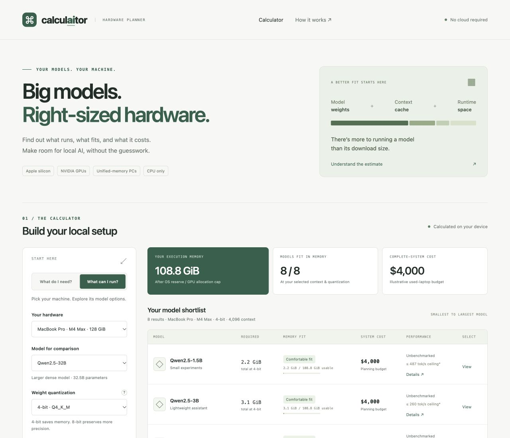

# calculAItor

**Find the right machine for your local AI models.**

[](LICENSE)
[](#deploy)
[](#quick-start)

How much hardware do you need for a 32B model? What can your MacBook run? Is a larger GPU worth the extra budget?

calculaitor helps you explore those questions before buying hardware. Choose a model to find machines with enough memory, or choose a machine to see which models fit. Compare complete-system budgets, inspect the assumptions, and find software to get started.



**37 hardware configurations · 9 model presets · No account, backend, or build step**

[Quick start](#quick-start) · [Features](#features) · [Hardware and models](#hardware-and-models) · [How estimates work](#what-the-estimates-mean) · [Contributing data](#update-the-catalogue) · [Deploy](#deploy)

## Features

| Start with… | Find out… |
| --- | --- |
| A model you want to run | Which machines have enough usable memory and the lowest reference budget |
| Hardware you already own | Which model sizes and quantizations fit at your chosen context length |
| A shortlist of machines | How up to three setups compare with the same model and settings |
| Your own configuration or quote | How custom memory, reserves, bandwidth, and local pricing change the estimate |

- Switch between 4-bit and 8-bit weights, choose FP16, 8-bit or 4-bit KV cache, and adjust total context length up to 1M tokens (default 128K).
- See separate allowances for model weights, context cache, runtime space, and the operating system.
- Inspect compatible tools, model licenses, hardware references, and price assumptions in each result.
- Calculate entirely in your browser, without analytics, API calls, or persistent storage. External references open only when you follow their links.

## Hardware and models

| Hardware family | Included examples |
| --- | --- |
| Apple desktops | Mac mini M4 / M4 Pro; Mac Studio M3 Ultra |
| Apple silicon laptops | MacBook Air M1–M5; MacBook Pro with M1–M5 Pro and Max chips |
| Intel laptops | 2019 16-inch and 2020 13-inch MacBook Pro, using conservative CPU-only estimates |
| AI and unified-memory PCs | NVIDIA DGX Spark; Ryzen AI Max+ 395 |
| Dedicated NVIDIA GPUs | Complete desktop budgets with RTX 5090, RTX 4060 Ti, and used RTX 3060 |
| Minimum viable setups | CPU-only PCs with 8 or 16 GiB RAM |

The model catalogue covers current large open-weight releases from 26B to 1T: Qwen3.8-27B, Qwen3.8-Flash-Next and Qwen3.5-397B-A17B, MiniMax M3.1 Flash and M3, Gemma 4 (26B-A4B and 31B), Mistral Medium 3.5, DeepSeek-V3.2, GLM-5.3, and Kimi K2 Thinking. Small and older models are deliberately left out. It is a representative planning sample; model quality and benchmark rankings are outside its scope.

Software guidance covers **llama.cpp**, **LM Studio**, and **Ollama**, with **MLX-LM** documented as an alternative format on Apple silicon. Each result narrows the guidance to its supported platform.

## Quick start

Requires Node.js 22 or newer. No dependencies to install.

```sh
git clone git@github.com:jmpsec/calculaitor.git
cd calculaitor
npm run dev
```

Open [the local preview](http://127.0.0.1:4173). Use `PORT=4200 npm run dev` to choose a different port. The development server listens on loopback only and serves `dist/`, not the repository.

Run the calculation and catalogue checks with `npm test`.

## Use the calculator

- **What do I need?** Choose a model, weight quantization and total context. Compare complete-system reference budgets and memory fit. The lowest comfortable budget is a memory recommendation, not a measured speed recommendation.
- **What can I run?** Choose a preset or “My custom hardware.” Enter system RAM, platform, and dedicated VRAM when applicable. Optional fields accept a bandwidth value, reserve override, and complete-system price.
- **Compare:** Select up to three machines and compare them using the same model and settings.
- **Local prices:** Choose USD, EUR, or GBP. Open a result’s details to save a complete-system quote in the selected currency. Other-currency prices remain labeled and are excluded from budget recommendations. There is no exchange-rate conversion. Quotes last for this page session; reset or reload restores reference values.
- **Inspect a result:** Click its name or Details for memory breakdown, runtime guidance, artifact and hardware sources, price assumptions, and model license.

## What the estimates mean

Required memory includes model weights, a full-context KV cache (FP16 by default, optionally q8_0 or q4_0) for one sequence, and runtime workspace. Calculations use bytes and display GiB (1,073,741,824 bytes). Artifact sizes are summed GGUF file bytes. A model name’s nominal parameter count is not its artifact size.

Each model lists its cache as groups of layers, so mixed architectures add up correctly:

```text
Cache = Σ groups: layers × elements per token × min(context, window) × bytes per element
        + fixed linear-attention state (FP32, not affected by cache precision)
Bytes per element: FP16 = 2, q8_0 = 34/32, q4_0 = 18/32 (including llama.cpp block scales)
Workspace = max(1 GiB, 5% of weights)
CPU / unified-memory OS reserve = max(4 GiB, 15% of RAM)
Dedicated GPU reserve = max(1 GiB, 5% of VRAM)
```

Elements per token depend on the attention type:

- **Grouped-query attention** (Mistral Medium, and the full-attention layers elsewhere): 2 × KV heads × head dimension.
- **Sliding window** (Gemma 4): the same, but capped at the 1,024-token window. Only the global layers grow with context. Gemma 4’s global layers share K and V; both are still counted.
- **Hybrid linear attention** (Qwen3.5 and later): only one layer in four keeps a KV cache. Gated DeltaNet layers hold a fixed recurrent and convolution state.
- **Multi-head latent attention** (DeepSeek, GLM, Kimi): KV LoRA rank + RoPE head dimension, the compressed latent llama.cpp caches. DeepSeek sparse attention adds a 128-element indexer key on its indexer layers.

A comfortable fit leaves at least 10% of usable execution memory free. A tight fit has less headroom. Unified RAM is counted once. The Ryzen AI Max preset also respects its documented 96 GiB graphics-allocation cap.

Dedicated-GPU models first need to fit in VRAM. “CPU offload” requires a documented partial-offload runtime and a conservative full model/cache/workspace fit in usable host RAM. It does not predict the exact layer split or speed. Disk swapping is not treated as sufficient memory. MoE models use all stored weights, not just active parameters. Models without cache metadata return an unavailable estimate.

**No matching measured benchmarks are bundled.** When bandwidth is documented, dense models that fit entirely in their execution memory may show a theoretical bandwidth ceiling: bandwidth bytes/second divided by weight bytes. This is not expected tokens/second. Compute, cache traffic, context, runtime, thermals, concurrency, and prompt processing affect actual performance. MoE and offloaded results have no ceiling estimate. Measure real setups with [llama-bench](https://github.com/ggml-org/llama.cpp/blob/master/tools/llama-bench/README.md).

## Data and price limitations

The catalogue contains 37 hardware configurations and 11 representative models from 26B to 1T, including eight MoE models. It is a compatibility sample, not a leaderboard or a claim to cover the latest model releases. Model metadata comes from each model’s Hugging Face config. GGUF sizes are summed file bytes from official, lmstudio-community, bartowski or unsloth GGUF repositories. GLM-5.3 has no published Q4_K_M build, so its 4-bit size uses the nominal-bit estimate. DeepSeek V4 and Kimi K3 are left out: their caches use new compressed or linear designs this calculator cannot estimate yet, or have no GGUF builds; every result links the relevant sources and license. The calculator does not download models or test physical machines.

Reference prices distinguish historical MSRP, announced MSRP, and illustrative planning budgets. GPU desktop budgets include both a GPU and a host-machine allowance; those are examples, not current retailer quotes. Generic CPU-only and used-system prices are also examples. Historical Mac configurations may no longer be orderable. Sources are dated; availability and prices can change. Tax, shipping, electricity, training, and recurring costs are excluded.

Laptop presets include MacBook Air and MacBook Pro across M1–M5, Pro and Max chips, plus 2019/2020 Intel MacBook Pros. Laptop prices are editable planning budgets, not market quotes. Intel presets use a conservative llama.cpp CPU path: integrated graphics and separate Radeon VRAM are excluded. Fanless Air models may throttle under sustained workloads.

MLX-LM is documented as an alternative for Apple silicon. Its checkpoint sizes differ from GGUF; do not treat these GGUF estimates as exact MLX allocations. DGX Spark guidance points to NVIDIA’s ARM64/Blackwell recipes. Custom configurations require verifying the actual driver, CPU instruction, and runtime support.

## Update the catalogue

Edit `dist/catalogue.js`:

1. Add a hardware record with a unique ID, memory topology, capacities in bytes, documented platform, runtime IDs, complete-system price or `null`, currency, price basis, condition, availability, source URLs, and verification date. Never add shared RAM to itself or treat GPU price as a full PC price.
2. Add a model record with its cache layer groups (built with the `gqa`, `mla` and `deltaNet` helpers from the model’s `config.json`), total parameters, optional active MoE parameters, context limit, supported quantization artifacts, sources, and license. Record summed GGUF file bytes for one build per quantization. `bytes: null` invokes the documented nominal-bit estimate with 10% overhead.
3. Add measured benchmarks only when the hardware/model/quantization/context/runtime/version and test conditions match. The `benchmarks` array documents the required shape through its consumer in `dist/calculator.js` and tests.
4. Run `npm test`, inspect both calculator modes, and check the affected result’s source links.

`dist/calculator.js` contains pure calculation and ranking functions. `dist/app.js` owns session state and DOM rendering. The page runs locally without external fonts, libraries, analytics, API calls, or persistent storage. Clicking source and setup links opens those providers’ websites.

## Deploy

Serve the contents of `dist/` from any static host, such as GitHub Pages, Cloudflare Pages, or an ordinary HTTP server. There is no build step, backend, SPA rewrite requirement, or environment secret. Keep the files together; the native JavaScript modules need an HTTP origin rather than a `file://` URL.

The MIT license applies to this website’s code; model licenses are separate.
